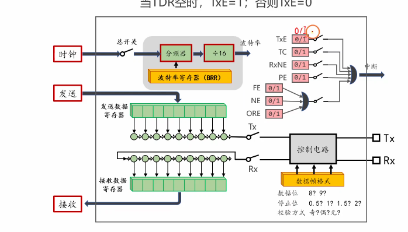
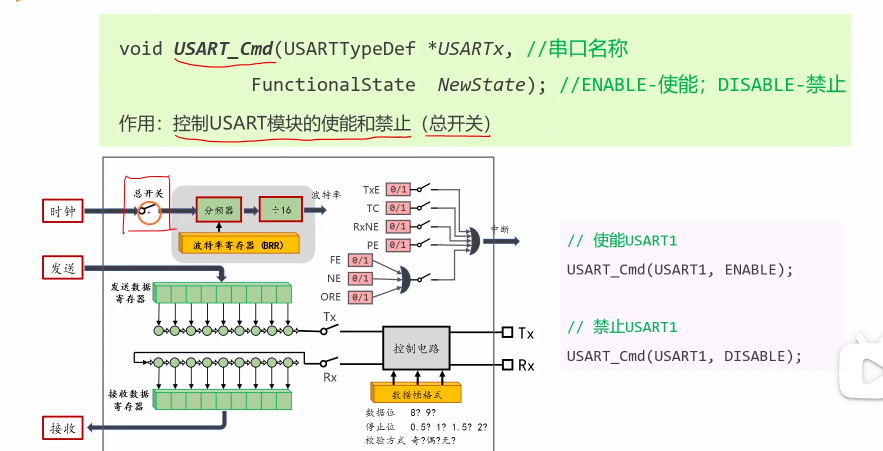
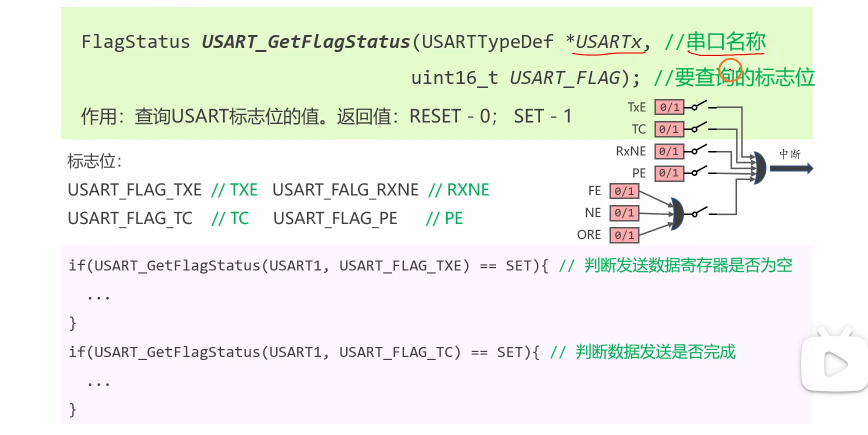
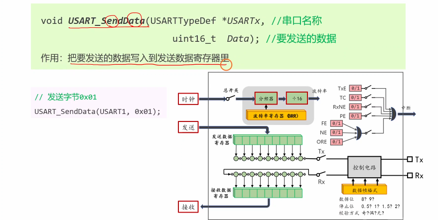
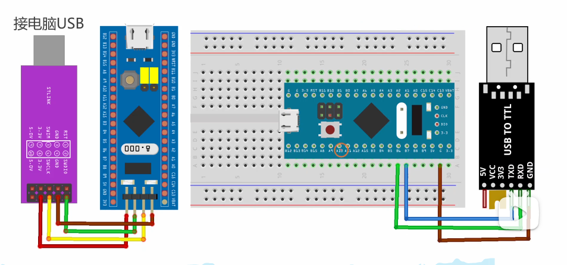
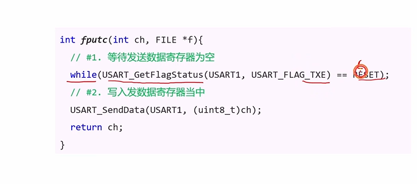
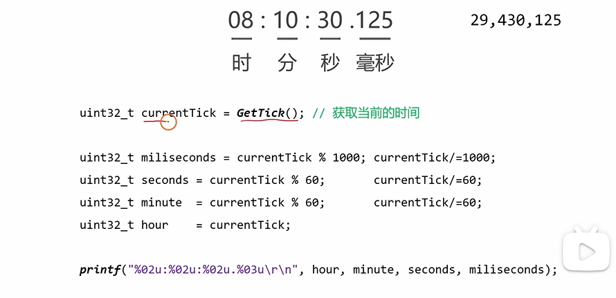

## 标志位

TxE:Transmit Data Register Empty - 发送数据寄存器空
当TDR空时，TxE=1；否则TxE=0

TC: Transmit Complete - 发送完成
当TDR空且移位寄存器空时，TC=1；否则TC=0



## 编程接口







## 编写代码

```c
#include "stm32f10x.h"

// 函数声明
void My_USART_SendBytes(USART_TypeDef *USARTx, uint8_t *pData, uint16_t Size);

int main(void)
{
	// ---------- 1. 开启时钟 ----------
	RCC_APB2PeriphClockCmd(RCC_APB2Periph_USART1, ENABLE);  // USART1 时钟
	RCC_APB2PeriphClockCmd(RCC_APB2Periph_GPIOB, ENABLE);   // 重映射后用的是 GPIOB
	RCC_APB2PeriphClockCmd(RCC_APB2Periph_AFIO, ENABLE);    // 开启 AFIO 时钟（重映射必须开）
	
	// ---------- 2. 配置重映射 ----------
	// 将 USART1 的 TX/RX 从默认的 PA9/PA10 映射到 PB6/PB7
	GPIO_PinRemapConfig(GPIO_Remap_USART1, ENABLE);
	
	// ---------- 3. 配置 GPIO 引脚 ----------
	GPIO_InitTypeDef GPIO_InitStruct;
	
	// 配置 PB6 (TX 发送引脚)
	GPIO_InitStruct.GPIO_Pin = GPIO_Pin_6;
	GPIO_InitStruct.GPIO_Mode = GPIO_Mode_AF_PP;     // 复用推挽输出
	GPIO_InitStruct.GPIO_Speed = GPIO_Speed_10MHz;
	GPIO_Init(GPIOB, &GPIO_InitStruct);
	
	// 配置 PB7 (RX 接收引脚)
	GPIO_InitStruct.GPIO_Pin = GPIO_Pin_7;
	GPIO_InitStruct.GPIO_Mode = GPIO_Mode_IPU;       // 上拉输入
	GPIO_Init(GPIOB, &GPIO_InitStruct);
	
	// ---------- 4. 配置 USART1 参数 ----------
	USART_InitTypeDef USART_InitStruct;
	USART_InitStruct.USART_BaudRate = 115200;
	USART_InitStruct.USART_Mode = USART_Mode_Tx | USART_Mode_Rx;
	USART_InitStruct.USART_WordLength = USART_WordLength_8b;
	USART_InitStruct.USART_StopBits = USART_StopBits_1;
	USART_InitStruct.USART_Parity = USART_Parity_No;
	
	USART_Init(USART1, &USART_InitStruct);
	
	// ---------- 5. 开启串口总开关 ----------
	USART_Cmd(USART1, ENABLE); // 闭合总开关
	
	// ---------- 6. 发送测试数据 ----------
	uint8_t bytesToSend[] = {1, 2, 3, 4, 5};
	My_USART_SendBytes(USART1, bytesToSend, 5);
}

// ==========================================
// 自定义的发送函数（核心逻辑）
// ==========================================
void My_USART_SendBytes(USART_TypeDef *USARTx, uint8_t *pData, uint16_t Size)
{
	for(uint32_t i = 0; i < Size; i++)
	{
		// #1. 等待发送数据寄存器为空（TXE = Transmit data register Empty）
		// 只有上一个字节发完了，寄存器空了，才能发下一个
		while(USART_GetFlagStatus(USARTx, USART_FLAG_TXE) == RESET);
		
		// #2. 写入数据寄存器当中
		USART_SendData(USARTx, pData[i]);
	}
	
	// #3. 等待最后一个数据发送完成（TC = Transmission Complete）
	// TXE 只代表寄存器空了，不代表最后一个字节真正发到线路上
	while(USART_GetFlagStatus(USARTx, USART_FLAG_TC) == RESET);
}
```

## 实验



**实验提示串口不存在被占用，删掉com5端口重新安装重启即可**

## 格式化字符串的编程原理

### 重写fputc函数





**串口助手显示空白可能是你自己写程序重复（void）My_USART1_Init();了**

```c
int main(void)
{
	      Delay_Init();
        My_USART1_Init();

    // printf("Hello world. \r\n");

    while(1)
    {
        uint32_t currentTick = GetTick();

        uint32_t miliSeconds = currentTick % 1000;
        currentTick = currentTick / 1000;

        uint32_t seconds = currentTick % 60;
        currentTick = currentTick / 60;

        uint32_t minutes = currentTick % 60;
        currentTick = currentTick / 60;

        uint32_t hour = currentTick;

        printf("%02u:%02u:%02u.%03u\r\n", hour, minutes, seconds, miliSeconds);

        Delay(100);
    }
}
```