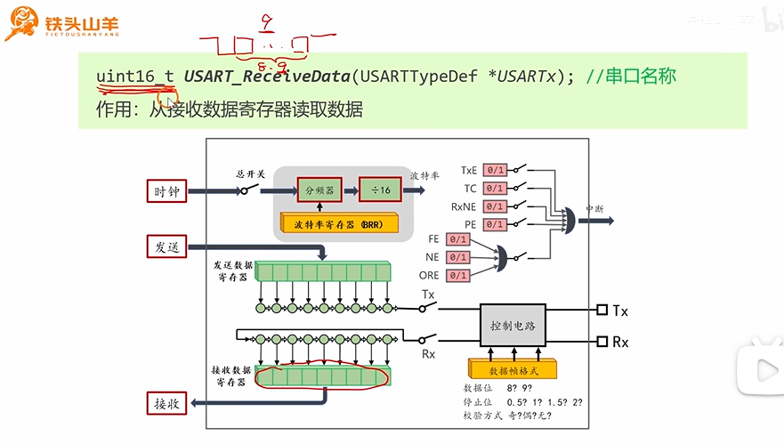
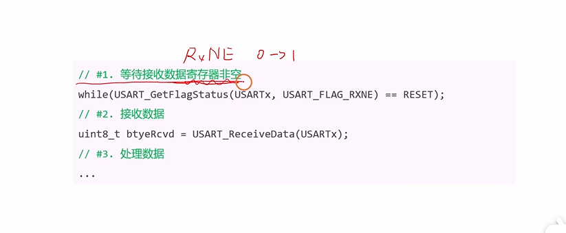
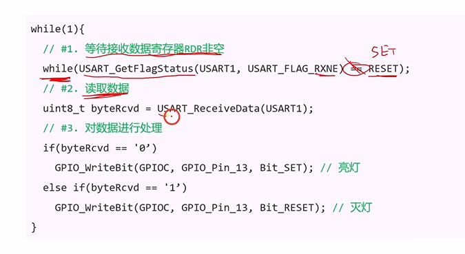
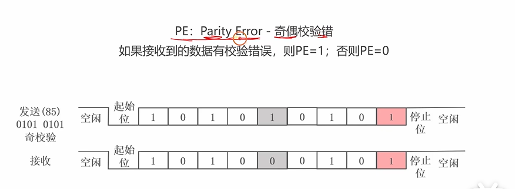
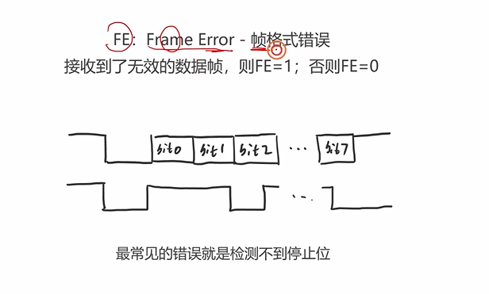
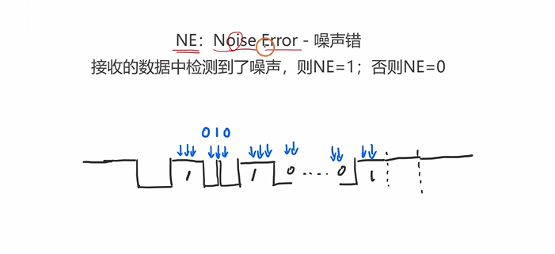
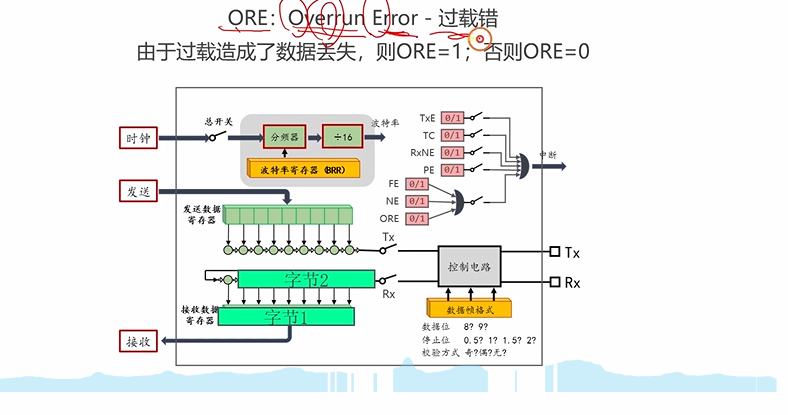

## 标志位

RxNE: Receive Data Register Not Empty - 接收数据寄存器非空
当RDR非空时，RxNE=1；否则RxNE=0





```c
#include "stm32f10x.h"//串口控制小灯实验
#include "stdio.h"
#include "Delay.h"

// 函数声明
void My_USART_SendBytes(USART_TypeDef *USARTx, uint8_t *pData, uint16_t Size);
void My_USART1_Init(void);
void My_GPIOC_Init(void);

int main(void)
{
        My_USART1_Init();
				My_GPIOC_Init();

	while(1){
		while(USART_GetFlagStatus(USART1, USART_FLAG_RXNE) == RESET);
// #2.接收数据
uint8_t btyeRcvd= USART_ReceiveData (USART1);
	if(btyeRcvd=='1') GPIO_WriteBit(GPIOC, GPIO_Pin_13, Bit_SET);   // 写1
	 else if(btyeRcvd=='0') GPIO_WriteBit(GPIOC, GPIO_Pin_13, Bit_RESET); // 写0

}
}

void My_USART1_Init(void){
// ---------- 1. 开启时钟 ----------
	RCC_APB2PeriphClockCmd(RCC_APB2Periph_USART1, ENABLE);  // USART1 时钟
	RCC_APB2PeriphClockCmd(RCC_APB2Periph_GPIOB, ENABLE);   // 重映射后用的是 GPIOB
	RCC_APB2PeriphClockCmd(RCC_APB2Periph_AFIO, ENABLE);    // 开启 AFIO 时钟（重映射必须开）
	
	// ---------- 2. 配置重映射 ----------
	// 将 USART1 的 TX/RX 从默认的 PA9/PA10 映射到 PB6/PB7
	GPIO_PinRemapConfig(GPIO_Remap_USART1, ENABLE);
	
	// ---------- 3. 配置 GPIO 引脚 ----------
	GPIO_InitTypeDef GPIO_InitStruct;
	
	// 配置 PB6 (TX 发送引脚)
	GPIO_InitStruct.GPIO_Pin = GPIO_Pin_6;
	GPIO_InitStruct.GPIO_Mode = GPIO_Mode_AF_PP;     // 复用推挽输出
	GPIO_InitStruct.GPIO_Speed = GPIO_Speed_10MHz;
	GPIO_Init(GPIOB, &GPIO_InitStruct);
	
	// 配置 PB7 (RX 接收引脚)
	GPIO_InitStruct.GPIO_Pin = GPIO_Pin_7;
	GPIO_InitStruct.GPIO_Mode = GPIO_Mode_IPU;       // 上拉输入
	GPIO_Init(GPIOB, &GPIO_InitStruct);
	
	// ---------- 4. 配置 USART1 参数 ----------
	USART_InitTypeDef USART_InitStruct;
	USART_InitStruct.USART_BaudRate = 115200;
	USART_InitStruct.USART_Mode = USART_Mode_Tx | USART_Mode_Rx;
	USART_InitStruct.USART_WordLength = USART_WordLength_8b;
	USART_InitStruct.USART_StopBits = USART_StopBits_1;
	USART_InitStruct.USART_Parity = USART_Parity_No;
	
	USART_Init(USART1, &USART_InitStruct);
	
	// ---------- 5. 开启串口总开关 ----------
	USART_Cmd(USART1, ENABLE); // 闭合总开关

}

int fputc(int ch, FILE *f){
    // #1. 等待发送数据寄存器为空 TXE = 1
    while(USART_GetFlagStatus(USART1, USART_FLAG_TXE) == RESET);
    
    // #2. 写入发数据寄存器当中
    USART_SendData(USART1, (uint8_t)ch);
    
    return ch;
}
void My_GPIOC_Init(void){
	
// #1. 开启GPIOC的时钟
	RCC_APB2PeriphClockCmd(RCC_APB2Periph_GPIOC, ENABLE);
	
	// #2. 初始化IO引脚，PC13 通用输出开漏模式 2MHz
	GPIO_InitTypeDef GPIO_InitStruct = {0};
	
	GPIO_InitStruct.GPIO_Pin = GPIO_Pin_13;
	GPIO_InitStruct.GPIO_Mode = GPIO_Mode_Out_OD;
	GPIO_InitStruct.GPIO_Speed = GPIO_Speed_2MHz;
	
	GPIO_Init(GPIOC, &GPIO_InitStruct);

}
```
**while里面别忘记放输入，不然只有一次输入**






## 封装
Fn+Fxx