## I2C模块

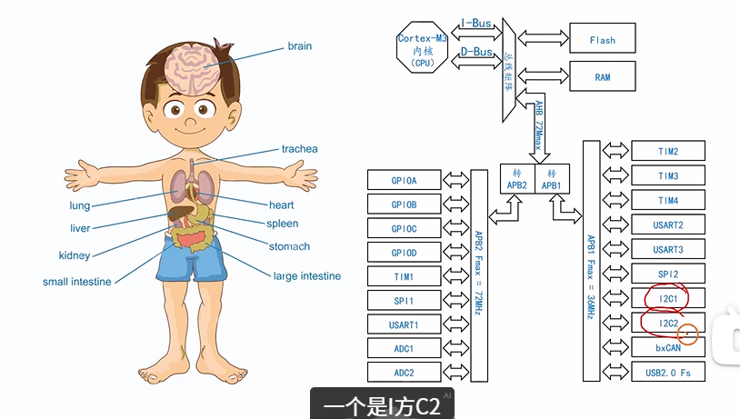

## IO引脚初始化

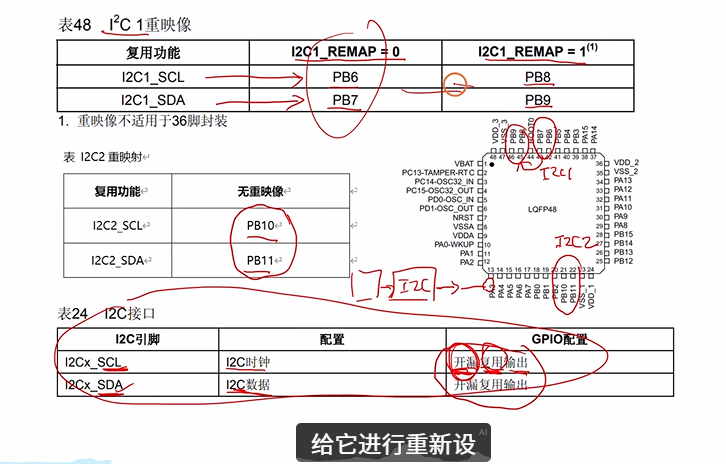

```c
void My_I2C_Init(void){
// ---------- 1. 开启时钟 ----------
	RCC_APB2PeriphClockCmd(RCC_APB2Periph_GPIOB, ENABLE);   // 重映射后用的是 GPIOB
	RCC_APB2PeriphClockCmd(RCC_APB2Periph_AFIO, ENABLE);    // 开启 AFIO 时钟（重映射必须开）
	
	// ---------- 2. 配置重映射 ----------
	GPIO_PinRemapConfig(GPIO_Remap_I2C1, ENABLE);
	
	// ---------- 3. 配置 GPIO 引脚 ----------
	GPIO_InitTypeDef GPIO_InitStruct;
	
	GPIO_InitStruct.GPIO_Pin = GPIO_Pin_8 | GPIO_Pin_9;
	GPIO_InitStruct.GPIO_Mode = GPIO_Mode_AF_OD;     
	GPIO_InitStruct.GPIO_Speed = GPIO_Speed_2MHz;
	GPIO_Init(GPIOB, &GPIO_InitStruct);
	GPIO_Init(GPIOB, &GPIO_InitStruct);
}
```
## 连接电路

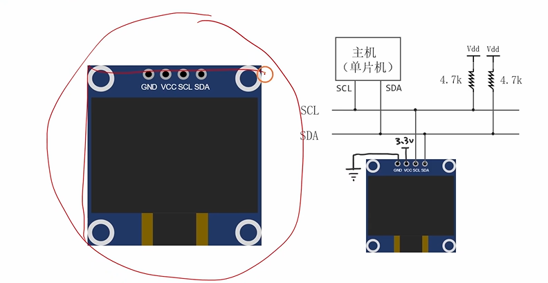
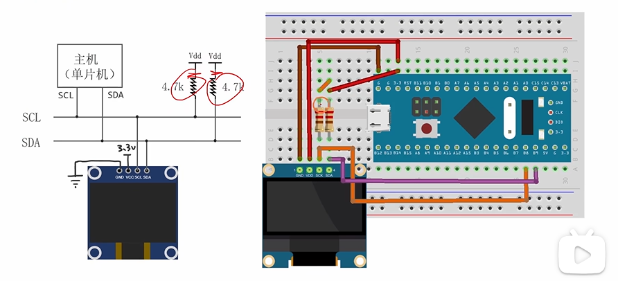

## I2C的速度模式

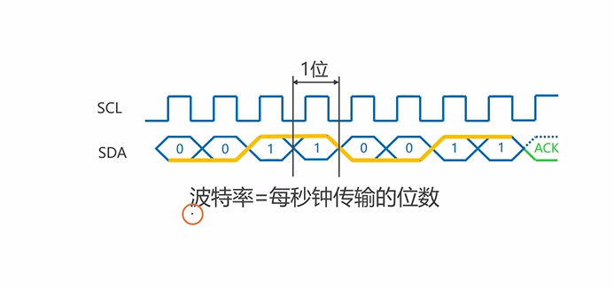
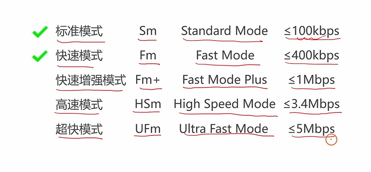

## 时钟信号的占空比

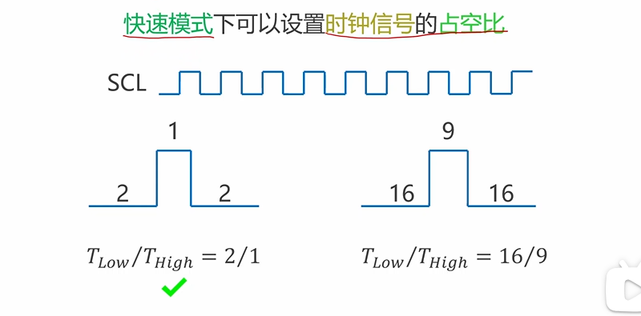

## I2C模块的初始化

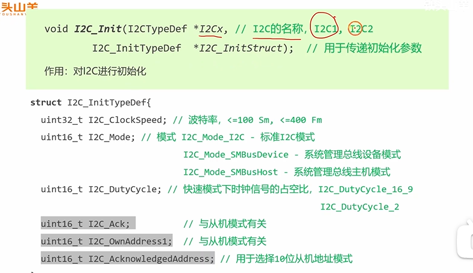
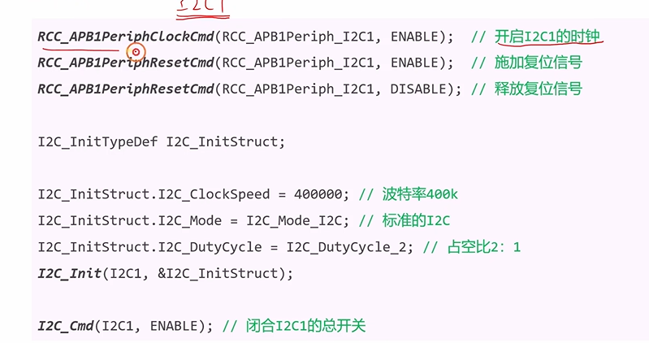

```c
// #2. 初始化I2C1模块
 RCC_APB1PeriphClockCmd(RCC_APB1Periph_I2C1, ENABLE);
 RCC_APB1PeriphResetCmd(RCC_APB1Periph_I2C1, ENABLE);  // 施加复位信号
 RCC_APB1PeriphResetCmd(RCC_APB1Periph_I2C1, DISABLE); // 释放复位信号
 I2C_InitTypeDef I2C_InitStruct;
 I2C_InitStruct.I2C_ClockSpeed = 400000;
 I2C_InitStruct.I2C_Mode = I2C_Mode_I2C;
 I2C_InitStruct.I2C_DutyCycle = I2C_DutyCycle_2;
 I2C_Init(I2C1, &I2C_InitStruct);
 
 I2C_Cmd(I2C1, ENABLE); 
 ```
 ## I2C模块内部结构框图

 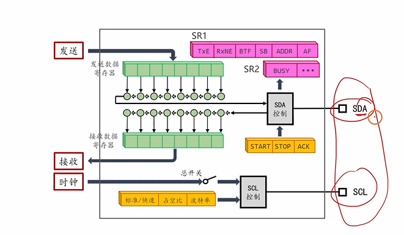

 ## 等待总线空闲

 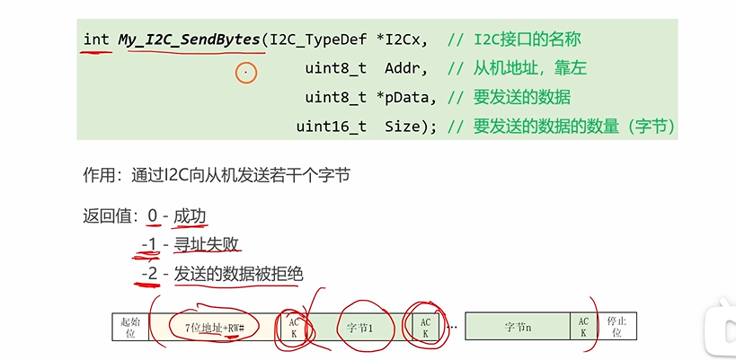
 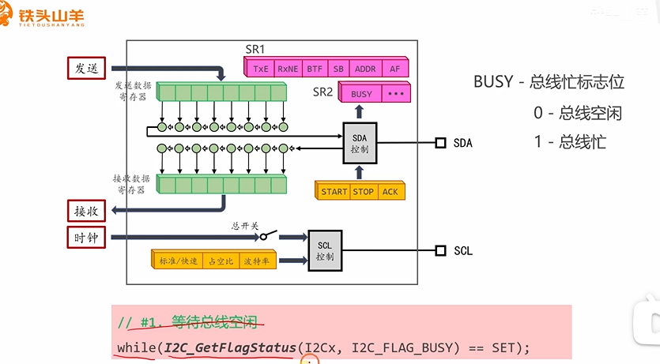

  ## 发送起始位

  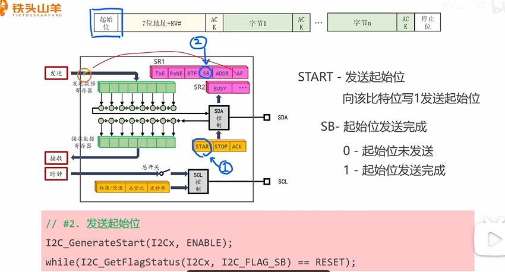

  ## 发送地址

  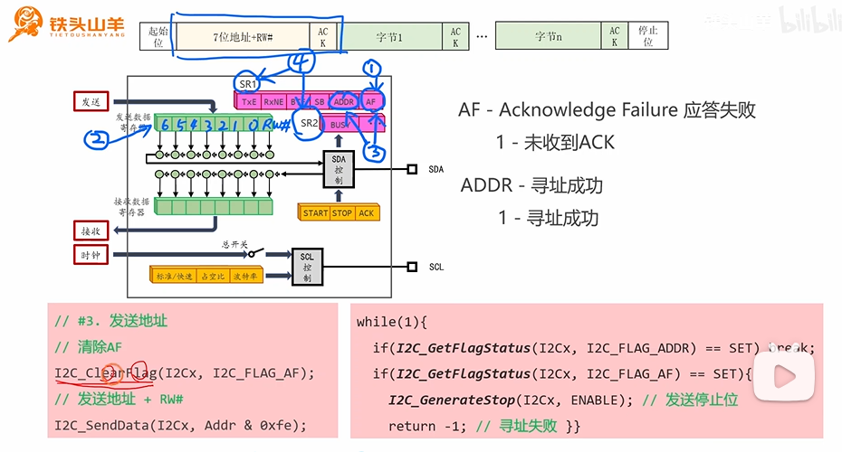
  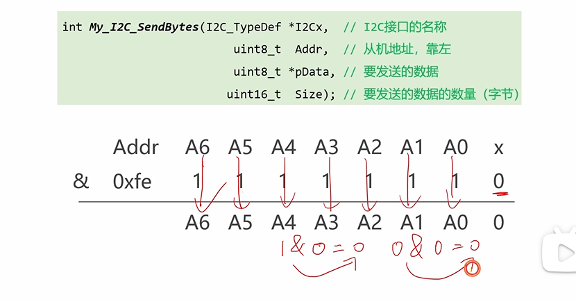
  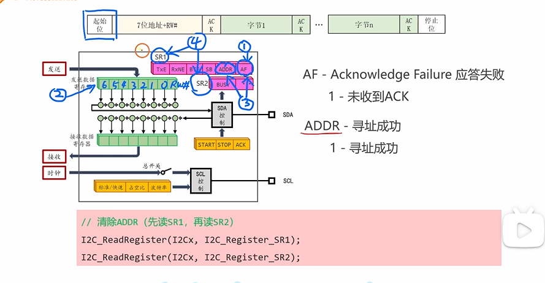

   ## 发送数据

   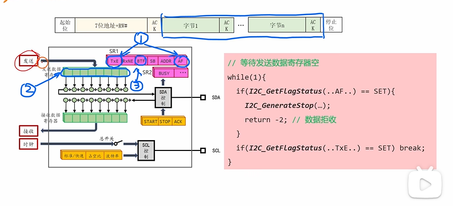

```c
   // 清除ADDR
I2C_ReadRegister(I2Cx, I2C_Register_SR1);
I2C_ReadRegister(I2Cx, I2C_Register_SR2);

// #4. 发送数据
for(uint16_t i=0; i<Size; i++)
{
    while(1)
    {
        if(I2C_GetFlagStatus(I2Cx, I2C_FLAG_AF) == SET)
        {
            I2C_GenerateSTOP(I2Cx, ENABLE);
        }
        if(I2C_GetFlagStatus(I2Cx, I2C_FLAG_TXE) == SET)
        {
            break;
        }
    }
    I2C_SendData(I2Cx, pData[i]);
}
```
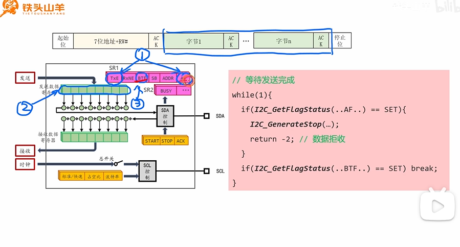

## 发送停止位

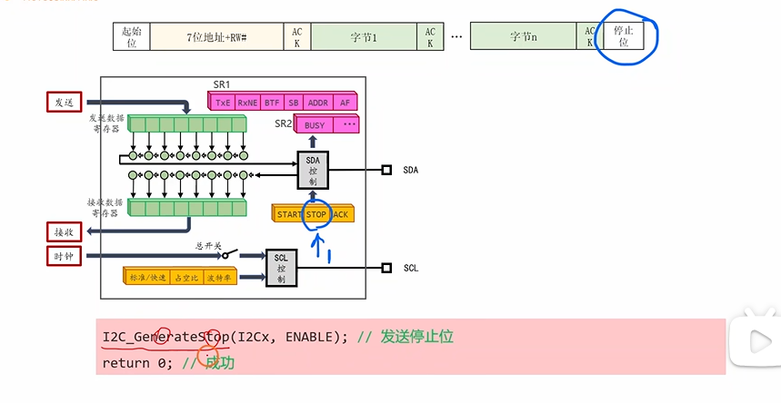

## 屏幕点亮

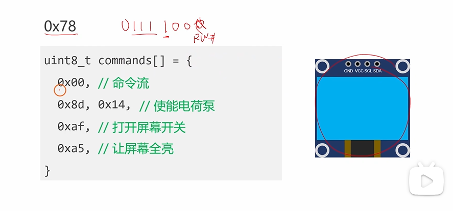

```c
int My_I2C_SendBytes(I2C_TypeDef *I2Cx,uint8_t addr,uint8_t *pData,uint16_t Size)
{
	//1.等待总线空闲
	while(I2C_GetFlagStatus(I2Cx,I2C_FLAG_BUSY)==SET);//BUSY:总线标志位，0：空闲；1：忙
	//2.发送起始位
	I2C_GenerateSTART(I2Cx,ENABLE);//发送起始位
	while(I2C_GetFlagStatus(I2Cx,I2C_FLAG_SB)==RESET);//SB：起始位发送状态；0：未发送；1：发送完成
	//3.寻址阶段
	I2C_ClearFlag(I2Cx,I2C_FLAG_AF);//清除AF标志位，AF：应答失败，1：未收到ACK
	I2C_SendData(I2Cx,addr & 0xfe);//发送地址+RW#
	while(1){
		if(I2C_GetFlagStatus(I2Cx,I2C_FLAG_ADDR)==SET)break;//ADDR:寻址成功；
		if(I2C_GetFlagStatus(I2Cx,I2C_FLAG_AF)==SET){
			I2C_GenerateSTOP(I2Cx,ENABLE);//发送停止位并返回-1，寻址失败
			return -1;
		}
	}
	//清除ADDR
	I2C_ReadRegister(I2Cx,I2C_Register_SR1);
	I2C_ReadRegister(I2Cx,I2C_Register_SR2);
	//4.发送数据
	for(uint16_t i=0;i<Size;i++){
		while(1){
			if(I2C_GetFlagStatus(I2Cx,I2C_FLAG_AF)==SET){
				I2C_GenerateSTOP(I2Cx,ENABLE);
				return -2;//数据被拒收
			}
			if(I2C_GetFlagStatus(I2Cx,I2C_FLAG_TXE)==SET)break;
		}
		I2C_SendData(I2Cx,pData[i]);
	}
	
	while(1)
	{
		if(I2C_GetFlagStatus(I2Cx,I2C_FLAG_AF)==SET){
			I2C_GenerateSTOP(I2Cx,ENABLE);
			return -2;
		}
		if(I2C_GetFlagStatus(I2Cx,I2C_FLAG_BTF)==SET){
			break;
		}
	}
	I2C_GenerateSTOP(I2Cx,ENABLE);
	return 0;
	
}
```


## 读数据

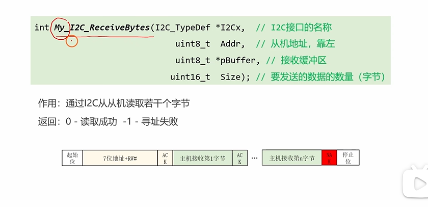
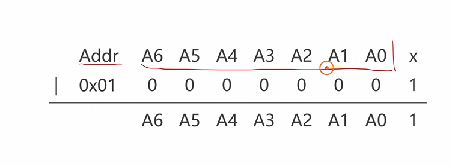
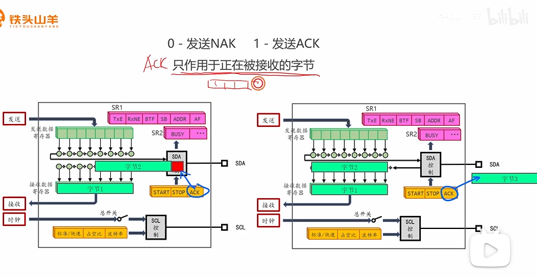
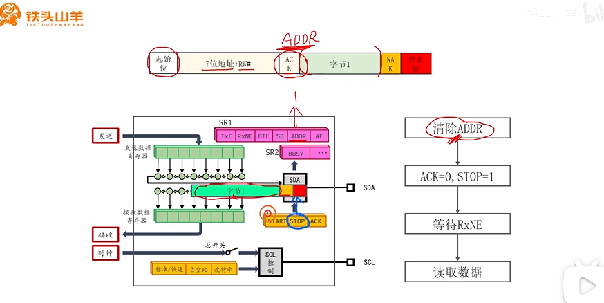
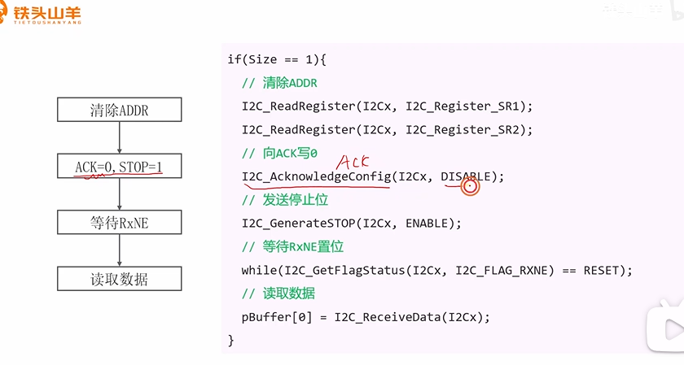

```c
int My_I2CReceiveBytes(I2C_TypeDef*I2Cx,uint8_t Addr,uint8_t*pBuffer,uint16_t Size)
{
	//1.发送起始位
	I2C_GenerateSTART(I2Cx,ENABLE);
	while(I2C_GetFlagStatus(I2Cx,I2C_FLAG_SB)==RESET);
	//2.寻址阶段
	I2C_ClearFlag(I2Cx,I2C_FLAG_AF);
	I2C_SendData(I2Cx,Addr|0x01);
	while(1){
		if(I2C_GetFlagStatus(I2Cx,I2C_FLAG_AF)==SET){
			I2C_GenerateSTOP(I2Cx,ENABLE);
			return -1;//寻址失败
		}
		if(I2C_GetFlagStatus(I2Cx,I2C_FLAG_ADDR)==SET)
		{break;}
	}
	//3.接收数据
	if(Size==1){
		//清除ADDR
		I2C_ReadRegister(I2Cx,I2C_Register_SR1);
		I2C_ReadRegister(I2Cx,I2C_Register_SR2);
		//ACK=0,STOP=1
		I2C_AcknowledgeConfig(I2Cx,DISABLE);
		I2C_GenerateSTOP(I2Cx,ENABLE);
		//RxNE->1
		while(I2C_GetFlagStatus(I2Cx,I2C_FLAG_RXNE)==RESET);
		//读取数据
		pBuffer[0]=I2C_ReceiveData(I2Cx);
		
	}else if(Size==2){
		//清除ADDR标志位
		I2C_ReadRegister(I2Cx,I2C_Register_SR1);
		I2C_ReadRegister(I2Cx,I2C_Register_SR2);
		//ACK=1
		I2C_AcknowledgeConfig(I2Cx,ENABLE);
		//等待接收完成
		while(I2C_GetFlagStatus(I2Cx,I2C_FLAG_RXNE)==RESET);
		//读取第一个字节
		pBuffer[0]=I2C_ReceiveData(I2Cx);
		//ACK=0,STOP=1
		I2C_AcknowledgeConfig(I2Cx,DISABLE);
		I2C_GenerateSTOP(I2Cx,ENABLE);
		//等待接收完成
		while(I2C_GetFlagStatus(I2Cx,I2C_FLAG_RXNE)==RESET);
		pBuffer[1]=I2C_ReceiveData(I2Cx);
	}else{//size>2
		//清除ADDR标志位
		I2C_ReadRegister(I2Cx,I2C_Register_SR1);
		I2C_ReadRegister(I2Cx,I2C_Register_SR2);
		//ACK=1
		I2C_AcknowledgeConfig(I2Cx,ENABLE);
		for(uint16_t i=0;i<Size-1;i++){
				//等待接收完成
				while(I2C_GetFlagStatus(I2Cx,I2C_FLAG_RXNE)==RESET);
				//读取数据
				pBuffer[i]=I2C_ReceiveData(I2Cx);
		}
			//ACK=0,STOP=1
		I2C_AcknowledgeConfig(I2Cx,DISABLE);
		I2C_GenerateSTOP(I2Cx,ENABLE);
		//等待接收完成
		while(I2C_GetFlagStatus(I2Cx,I2C_FLAG_RXNE)==RESET);
		pBuffer[Size-1]=I2C_ReceiveData(I2Cx);
	}
	return 0;
	
}
```

**显示屏带灯**
```c
int main(void)
{
	My_I2C_Init();
	My_boardLED_Init();
	uint8_t c[]={0x00,0x8d,0x14,0xaf,0xa5};
	My_I2C_SendBytes(I2C1,0x78,c,5);
	uint8_t rcvd;
	My_I2CReceiveBytes(I2C1,0x78,&rcvd,1);
	if((rcvd&(0x01<<6))==0){
		GPIO_WriteBit(GPIOC,GPIO_Pin_13,Bit_RESET);
	}else{
		GPIO_WriteBit(GPIOC,GPIO_Pin_13,Bit_SET);
	}
	
	while(1)
	{
		
	}
}
```
