## 深度学习基本信息

[点击查看 Python基础 PDF](/python-basics.pdf)

1. 人工智能是一个很大的概念，其中一个最重要的分支就是机器学习；
2. 机器学习的算法多种多样，其中最核心的就是神经网络；
3. 神经网络的隐藏层若足够深，就被称为深层神经网络，也即深度学习；
4. 深度学习包含深度神经网络（DNN处理大数据）、卷积神经网络（CNN处理计算机视觉）、循环神经网络（RNN自然语言处理）等。

## 编程基础
1. 敲代码时切换到*英文输入法*，所有符号均为英文状态；
2. Python 的注释以 *＃* 开头为标志，注释单独成行，或放在菜语句右侧：
3. Python是动态输入类型语言，像 Matlab一样，变量类型是*动态推断*的：静态类型C语言须声明变量类型，如 inta=1，而Python只需要a=1：
4. 编程语言中a=1含义是一一将数值1赋给变量a：
5. Python 里*换行符*（回车）可以替代分号 （；），所以一般不出现分号：
6. Python 里*四个空格*是一个*缩进*，不要随意在某行代码开头输入空格。
7. 像C语言和Matlab一样，变量名由*字母、数字、下划线*组成（但不能以**数字**开头），字母区分大小写，变量名不能与内置的函数同名。
8. 根据变量是否可以充当容器，将变量类型分为*基本类型*和*高级类型*。

基本变量类型：字符串、数字、布尔型；
高级变量类型：集合、元组、列表、字典。

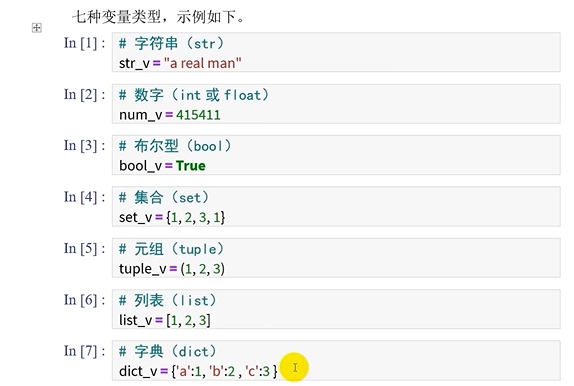

Python 语言时标准输出方法是：print（变量名）。
Jupyter中增加一种独特的输出方法，即在一个代码块内前最后一行写上变
量名，即可输出该变量的数值。

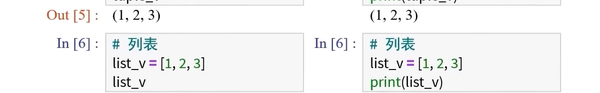

这里你可以暂时不理解变量之间区别，但必须理解一点：**print 函数的原理是输出仅一个单独的变量**，它只有这一种用法，其它前各种用法要么是输出了f字符串，要么是输出了元组，后续讲到字符串或元组时会重点提到输出语句。
### 基本变量类型
#### 字符串

（1）字符串的结构

字符串用引号括起来，双引号和单引号都可以。示例代码如下。
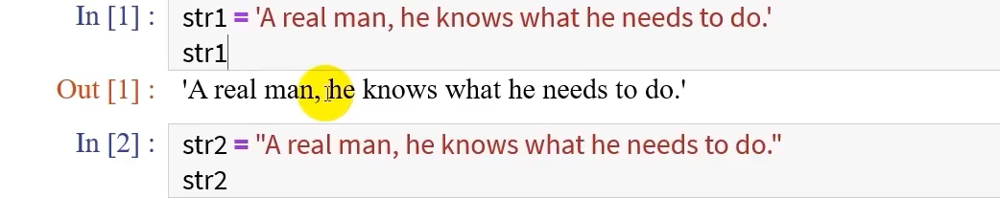

当字符串变量内含有单引号，就用双引号来表示该字符串；
当字符串变量内含有双引号，就用单引号来表示该字符串；

（2）输出语句的经典用法

想在字符串中插入其它变量，可使用“f字符串”的方法，代码示例如下。
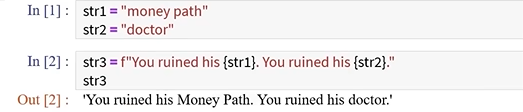

（3）输出语句的转义字符

在字符串中添加转义字符，如换行符\n 与制表符，可增加 print 的可读性。
同时，转义字符只有在 print 里才能生效，单独对字符串使用无效。

#### 数字

（1） 整数型数字和浮点型数字

数字有两种数据类型，分别是**整数（int）和浮点数（foat）**。这里暂时不用太过区分二者，进入下一节课《NumPy数组库》时才要注意区分。

（2）常用运算符

常用运算符如表1所示。

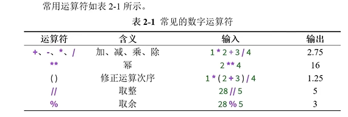

#### 布尔型

布尔型只有两个值（**True 和 False**），通常是基于其它变量类型来进行生成。

（1）基于基本变量类型生成

1. 对字符串作比较，使用等于号==与不等号!=；
2.  对数字作比较、使用大干>、大干等干>=、等干=、小干<、小干等干<=.

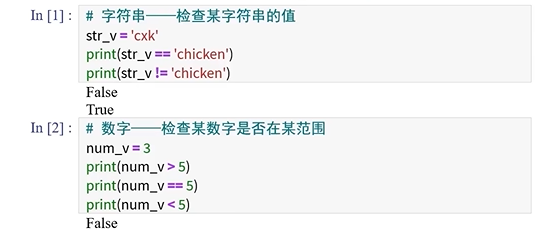

（2） 基于高级变量类型生成

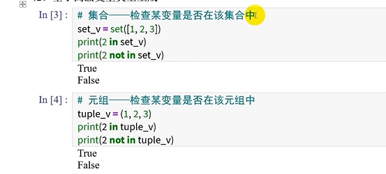

（3）同时检查多个条件

and 的规则是，两边全为 True 则为 True，其它情况均为 False；
or 的规则是，两边有一个是 True 则为 True，其他情况为 False。

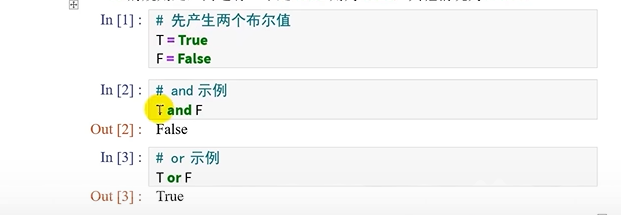

除了 and 和 or，还在一个布尔值前面加上 not，如 not True就是 False。

### 判断语句

bool 值通常作为if判断的条件，if判断的语法规则为

```py
if 布尔值：
情况一
elif 布尔值：
情况二
else:
其它情况
```

注意事项；
1. Python 的循环、判断、函数和类中均不使用 end 来表示代码块的结束；
Python 常常利用缩进（即四个空格）来表示代码块的范围：
每一个判断条件的最后有一个冒号，不要遗漏。
2. if语句中，if：只出现1次，elif：可出现0至∞次，else：可出现0或1次。

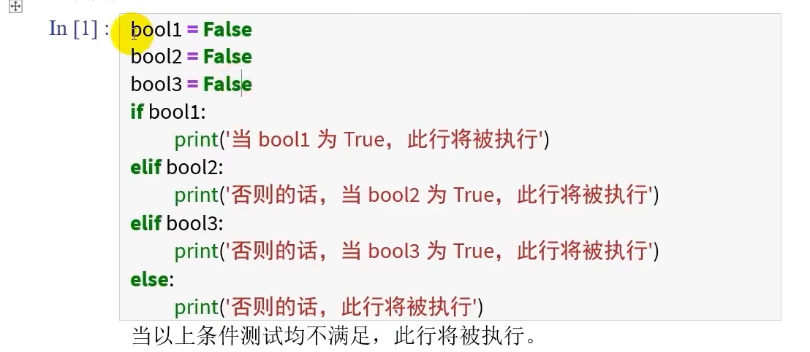

### 基本变量间的转换

字符串、整数、浮点数、布尔型四者之间可以无缝切换。
1. 转换为字符串使用 str 函数：
2. 转换为整数型数字使用 int 函数：
3. 转换为浮点型数字使用 float 函数：
4. 转换为布尔型使用 bool函数。

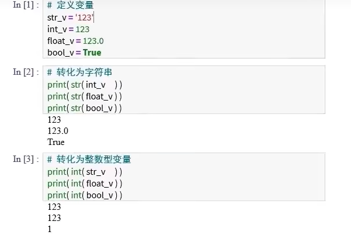

注：其它变量转为布尔型变量时，只有当字符串为空、数字为0、集合为空、元组为空、列表为空、字典为空时，结果才为 False。

### 高级变量类型

高级变量类型，即集合、元组、列表、字典，它们有一个共同特点：作为
容器，它们可以随意容纳任意变量（甚至在同一个容内包含7种变量类型）。

#### 集合

集合是无序、不可重复元素组合。
可以用两种方式创建集合：通过set 函数或使用大括号：

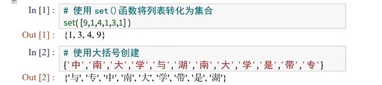

**注意，请勿用大括号创建空集合，否则会被误认为是字典。**
集合出现次数稀少，它更多是被看作是字典的索引（即数据标签）。考虑到后面我们会学习 Pandas库，可替代集合，因此这里就不再讨论集合了，以
后在别人代码里遇到了知道是集合就可以。

#### 元组

（1）创建元组

元组 ，是一个超厉害的变量类型（请不要将之与列表一同提起）。
有两种方式可以创建元组，一种是规范括号法，一种是省略括号法。

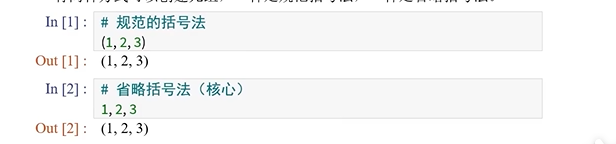

（2）输出语句中的元组法

**高级变量类型都可以容纳所有变量类型，如示例所示。**

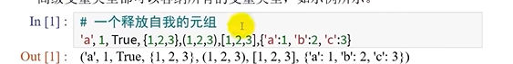

因此，如果你在 print 里忽然见到逗号，不必大惊小怪，示例如下。

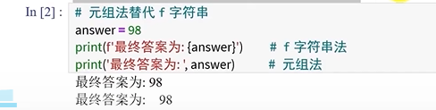

元组法输出相对于f字符串输出有个缺点，即输出的元素之间含有一个空格。

 （3）元组拆分法

 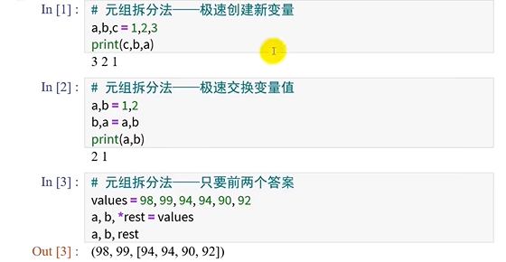

 #### 列表

（1）创建列表

列表由若干个有序的变量组成，其中的元素之间可以无任何关系。
列表出现的标志是中括号，列表里的变量使用逗号分隔，示例如下。

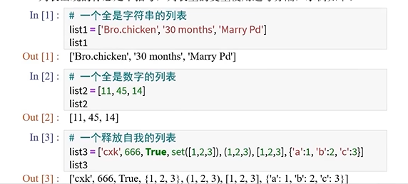

由 list3 可见，列表可以容纳各种变量类型，其代价是——列表要单独存每一个元素变量类型，列表越大越占空间。但是请仔细想想，深度学习其会出现类似list3 前这种列表吗？我想不会。
下一节课我们将介绍 NumPy库，其中的 NumPy数组仅接纳一种变量类型。

（2）访问与修改某个元素

访问列表元素时使用中括号，索引由0开始。
当想访问列表倒数第一个元素时，可使用 a［-1］；当想访问倒数第二个元素，可使用a［-2］，以此类推。
可以通过访问某列表元素的方式对其数值进行修改。

（3）切片——访问部分元素

切片，就是列表的一部分。在学习列表索引时，可结合图3-1所示。


当明确知道从第x个元素切到第y个元素，示例为：

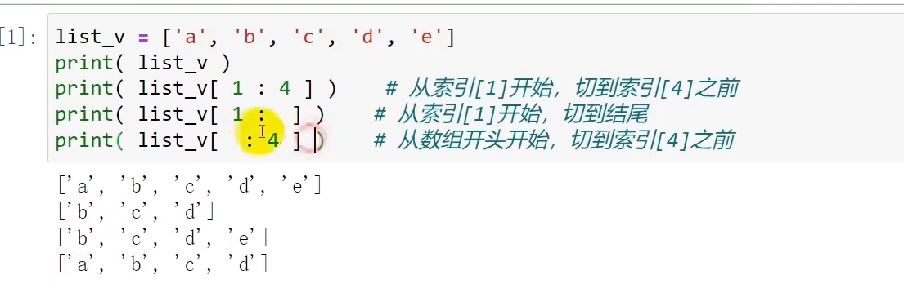

当明确切除列表的开头与结尾，如示例所示。

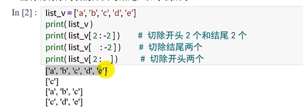

当明确隔几个元素采样一次时，示例如下。

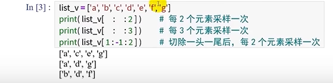

值得注意的是，对列表进行切片后得到一个新的对象，与原列表变量相互独
立，如示例所示。但是若存储几百万条数据，这无疑对电脑是一种全新的考验。

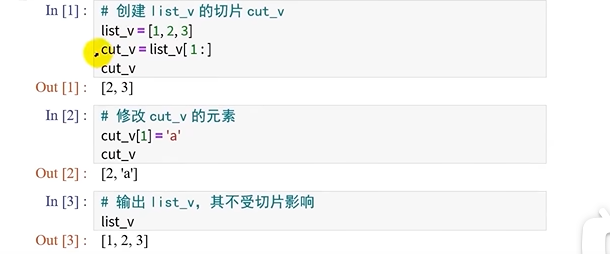

为此，NumPy 的切片被设定为是原对象的一个视图，不会在内存中创建一
个新对象，改变 NumPy切片上的对象会影响原 NumPy 数组，因此其比 Matlab更6。那 NumPy 真想提取部分切片用于备份怎么办？届时使用.copy（）方法即可。

（4）列表元素旳添加

列表可以使用+和* 来添加原列表，示例如下。

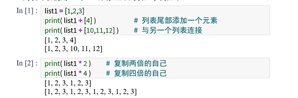

从这里可以看出，列表完全没有任何数组的特征，加减乘除油盐不进。看来
真的只能把列表看作为一个容器而已。
在 Numpy 中如何实现列表元素添加的功能呢？使用 numpy.concatenate 函数。基于此，NumPy的加减乘除得到解放，可以像 Matlab 一样对数组做数学运算。

#### 字典

（1）创建字典

字曲可以理解为升级版的列表，每个元素的索引都可以自己定，示例如下。

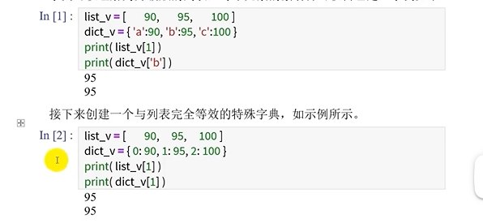

字典中的元素值可以是任何变量，字典中的索引只能是数字或者字符串，且一般都是字符串，如示例所示。

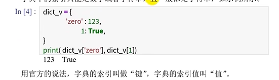

（2）字典元素的修改、添加与删除

现以学科名称为字典索引，以学科实力为索引值，示例如下。


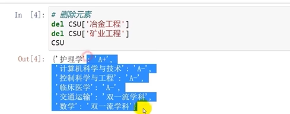